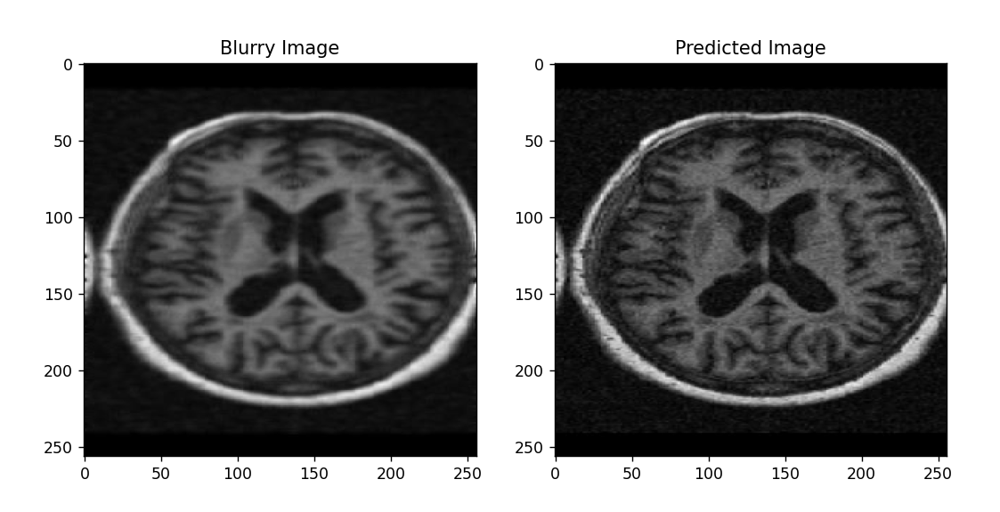
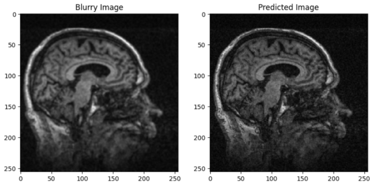
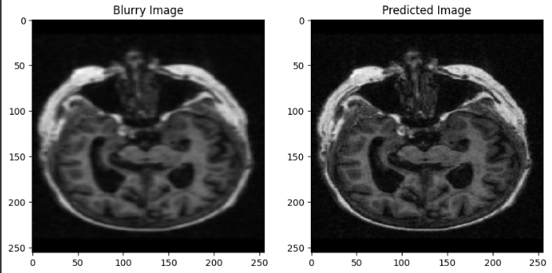

# De-Blurring of MRI Images

*Internship project at NESCOM, Islamabad (2024)*

A deep learning model that takes a blurry brain MRI image and gives back a sharper version of it. Blurry MRI scans (from patient movement or a weak signal) make it harder to see small details, so the idea was to clean them up before analysis.

## Results

The left side is the blurry input, the right side is what the model produced.

## How it works

- **Data:** 1474 pairs of grayscale brain MRI slices (from the OASIS dataset). Each pair has a clear image and a blurred copy of it. The blurred copies were made with a small Pillow script.
- **Preprocessing:** images resized to 256×256 and scaled to 0–1. 70% used for training, 30% for testing. Training images were randomly rotated, shifted, zoomed and flipped (data augmentation).
- **Model:** a convolutional autoencoder. The encoder shrinks the image with Conv2D layers, and the decoder rebuilds it with Conv2DTranspose layers. Batch normalization and dropout help it avoid overfitting.
- **Training:** MSE loss with the Adam optimizer, MAE tracked as well. The best model was saved automatically, and training stopped early when it stopped improving.

## Built with

Python, TensorFlow / Keras, NumPy, scikit-learn, Pillow, Matplotlib

The code is kept in a private repository.
